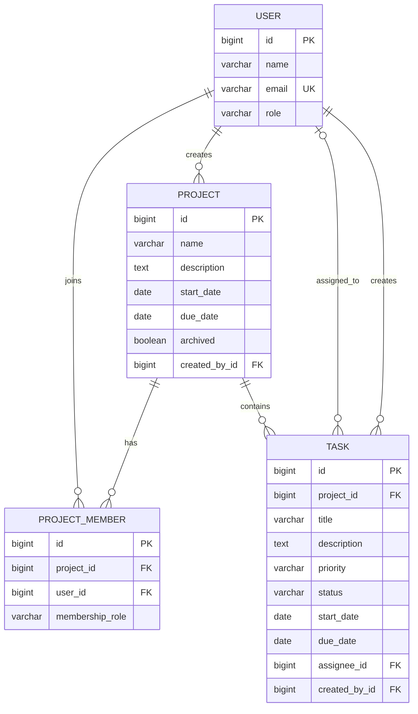

# Task Manager ER Diagram

## Relationship rules

- One user creates many projects; every project has exactly one creator.
- `ProjectMember` is the many-to-many join between users and projects. `(project_id, user_id)` is unique.
- A project owns many tasks. A task cannot exist without a valid project.
- A task has one creator and may have one assignee. The assignee must later be checked against project membership in the task service.
- Projects use a soft archive flag so historical tasks remain intact.

## Useful indexes

| Table | Index | Why |
|---|---|---|
| `users` | unique `email`; `role` | Login/identity lookup and role filtering |
| `projects` | `archived`; `created_by_id`; `(start_date, due_date)` | Active-project lists, ownership, and deadline views |
| `project_members` | unique `(project_id, user_id)`; `user_id` | Prevent duplicate members and list projects for a user |
| `tasks` | `(project_id, status)`; `(assignee_id, status)`; `due_date`; `priority` | Project boards, assignee queues, overdue tasks, and filtering |
